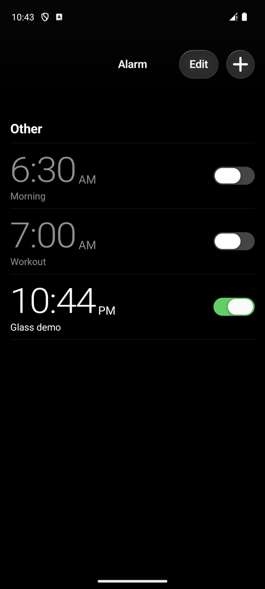
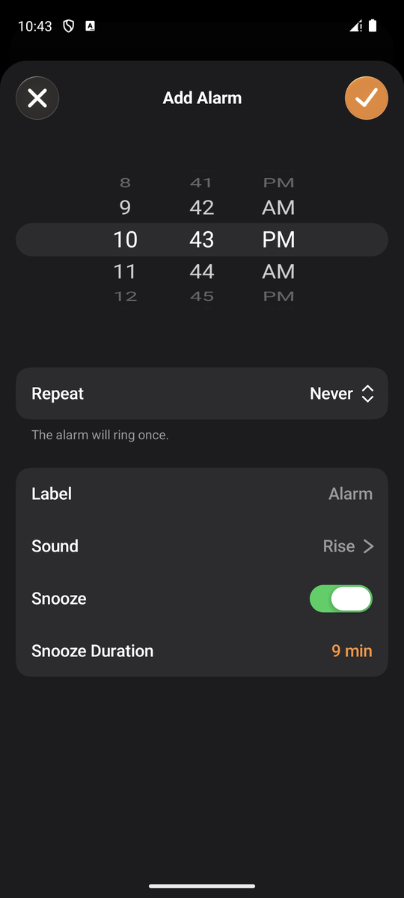
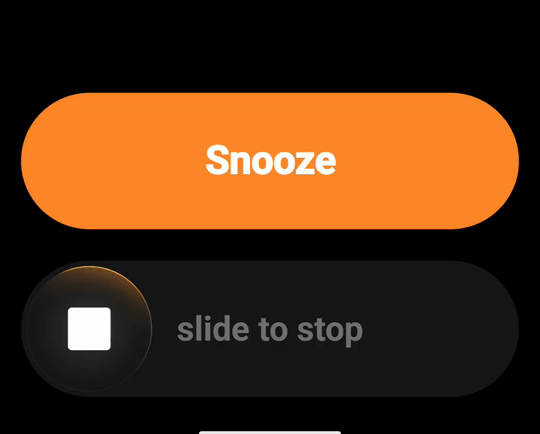
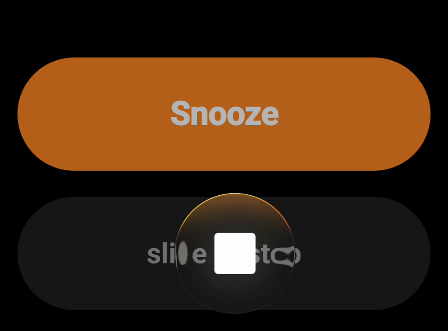
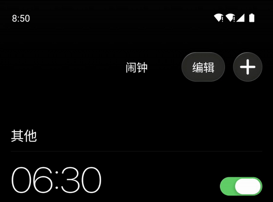
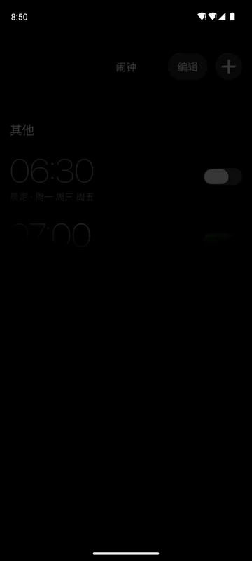
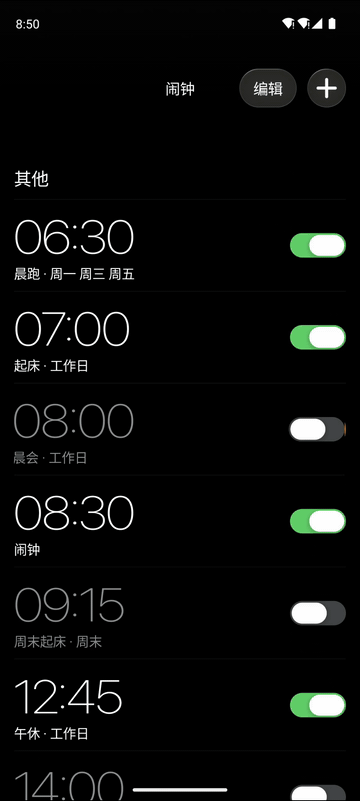
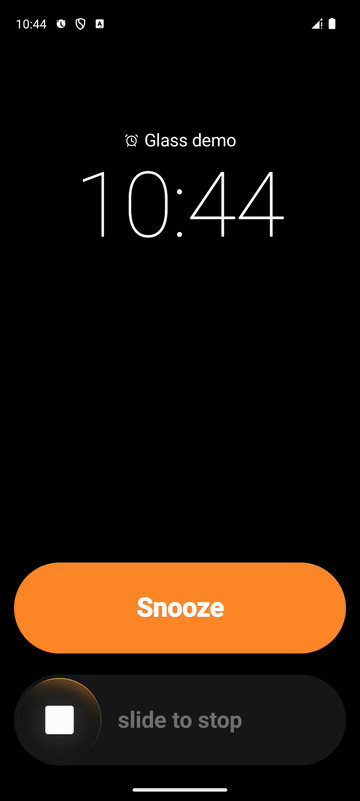

# iOS-Style Alarm for Android

**简体中文** | [English](README.en.md)

基于 Jetpack Compose 与 Android 13+ AGSL (`RuntimeShader`) 实现的 iOS 风格闹钟应用，包含独立封装的液态玻璃（Liquid Glass）光学控件库 `:glass`。

公开版使用 Android 系统字体与通用几何闹钟图标，不包含 Apple 字体或 SF Symbols 资源。三张界面截图、液态玻璃滑块特写与全屏响铃动图均录自公开版；列表滚动、顶栏模糊及编辑面板动图保留早期本地研究版演示，字体及小图标可能不同，液态玻璃渲染与手势实现相同。本项目与 Apple 无隶属关系。

<p align="center">
  
  
  
</p>

---

## 视觉与交互演示

### 1. 液态玻璃滑块（Liquid Glass Slider）与全屏响铃

响铃页底部控件由 `:glass` 模块提供。拖动「滑动以停止」滑块时，圆形玻璃透镜对下方轨道与文字执行实时 Snell 折射、RGB 三通道色散、边缘放大与 Fresnel 镜面高光，并动态采样上方橙色「稍后提醒」胶囊的面光源反射。

<p align="center">
  
  
</p>

### 2. 顶栏渐进高斯模糊与液态玻璃开关（GlassToggle / GlassButton）

列表滚入顶栏下方时，`progressiveTopBlur` 对实时列表执行双通道可分离高斯模糊（标准差 $\sigma$ 从顶部 `12dp` 平滑衰减至顶栏下方 `24dp` 处的 `0`）。右上角「编辑」与「+」按钮通过 `GlassBackdrop` 实时折射下方滚过的数字与开关；`GlassToggle` 在按压或水平拖动时放大为 `1.5x` 透明胶囊透镜。

<p align="center">
  
  
</p>

### 3. 模态编辑面板与 3D 圆柱滚轮

添加/编辑面板采用弹簧升起与下拉回弹手势，背景列表同步缩放至 `0.95x` 并过渡为圆角卡片；子页面（重复、标签、铃声、稍后提醒时长）具备视差推入与侧滑返回转场；时间滚轮采用圆柱透视投影与单格吸附反馈。

<p align="center">
  
  
</p>

---

## 架构设计

项目采用多模块结构与单向数据流（MVI），业务层与光学渲染层完全解耦：

```
ios-style-alarm/
├── app/                                # 闹钟应用主模块
│   └── src/main/
│       ├── java/tech/hezy/alarm/
│       │   ├── domain/                 # 闹钟领域模型与下一次触发时间计算
│       │   ├── data/                   # JSON 持久化、AlarmManager 精确调度、PCM 合成铃声
│       │   ├── mvi/                    # 轻量 MviViewModel 基类（StateFlow + reduce）
│       │   ├── ui/                     # 闹钟列表、渐进顶栏模糊、滚轮编辑面板与视差导航栈
│       │   └── ring/                   # 响铃前台服务、锁屏唤醒 Activity 与稍后提醒状态流
│       └── res/raw/
│           └── progressive_top_blur.agsl
└── glass/                              # 独立可复用 Liquid Glass GPU 控件库
    └── src/main/
        ├── java/tech/hezy/glassalarmslider/
        │   ├── GlassAlarmControls.kt   # 响铃页「稍后提醒 + 滑动以停止」组合控件与手势状态机
        │   ├── GlassAlarmRenderer.kt   # 滑块 AGSL 渲染器、扫光高光与 uniform 快照缓存
        │   ├── GlassSceneCapture.kt    # RenderNode 离屏降采样捕获与硬件高斯预模糊图集
        │   ├── GlassControlSurface.kt  # 胶囊玻璃表面渲染（供 GlassButton / GlassToggle 共用）
        │   ├── GlassBackdrop.kt        # 背景 DisplayList 录制与重放（避免递归采样与位图回读）
        │   ├── GlassButton.kt          # 顶栏与导航栏液态玻璃按钮
        │   └── GlassToggle.kt          # 液态玻璃开关（静止实白，按压/拖动展开为折射透镜）
        └── res/raw/
            ├── alarm_glass.agsl        # 响铃滑块光学着色器
            └── glass_control.agsl      # 胶囊按钮/开关光学着色器
```

---

## 核心实现说明

### 1. 液态玻璃光学着色器（`alarm_glass.agsl` & `glass_control.agsl`）

着色器在片元阶段基于解析有向距离场（SDF）恢复三维透镜表面法线，不依赖纹理贴图或硬件偏导指令：

- **几何与解析法线**：根据当前片元到滑块中心或胶囊轴线的归一化距离 $d$，由幂函数剖面计算法线高度分量 $n_z$ 与切向梯度，保证边缘抗锯齿与折射方向连续。
- **Snell 折射与三通道色散**：根据入射向量与法线计算折射位移，对 R / G / B 三个通道施加微小的折射率偏移（Chromatic Aberration），在透镜边缘产生自然的棱镜色散。
- **双源图集采样（`GlassSceneCapture`）**：当开启磨砂或降采样时，`GlassSceneCapture` 利用硬件加速 `RenderNode` 将源场景绘制一次并重放至「清晰捕获层」与「硬件 `RenderEffect.createBlurEffect` 预模糊层」拼接而成的双源图集，片元着色器在同一 `RuntimeShader` 内完成折射放大与磨砂混合，全程驻留 GPU，无 `Bitmap` CPU 回读。
- **面光源边缘反射**：实时计算滑块圆周法线朝向与上方橙色「稍后提醒」胶囊的几何距离，在滑块上沿生成随位置动态变化的橙色环境反射弧。

### 2. 顶栏渐进高斯模糊（`ProgressiveTopBlur.kt`）

为避免串联 `RuntimeShader` 导致 $33 \times 33 = 1089$ 次嵌套采样，`progressiveTopBlur` 使用两个独立的 `CompositingStrategy.Offscreen` 图层分别执行横向（`axis = (1, 0)`）与纵向（`axis = (0, 1)`）一维 33-tap 高斯卷积（共 $33 + 33 = 66$ 次采样）。模糊半径按纵坐标平滑衰减：

$$\sigma(y) = \sigma_{\max} \cdot \left(1 - \text{smoothstep}(0, y_{\text{fadeEnd}}, y)\right)$$

当 $\sigma(y) < 0.05$ 时直接返回原像素，跳过该片元的卷积循环；离屏图层与合成仍有开销，不能视为零开销。

### 3. 精确闹钟调度与运行时合成音频（`AlarmScheduler` & `AlarmSoundPlayer`）

- **调度**：使用 `AlarmManager.setAlarmClock` 注册系统级精确闹钟，支持单次响铃、按周重复、自定义稍后提醒时长（1–15 分钟）以及设备重启/时区变更后的广播重预约（`BootReceiver`）。
- **音频**：内置 5 种提示音（晨光、脉冲、玻璃、港湾、清澈），运行时合成两秒 PCM 缓冲，再交给 `AudioTrack` 循环播放，不依赖外部音频资产。

---

## 构建与运行

环境要求：**Android Studio Ladybug+**，**JDK 17**，目标设备 **Android 13 (API 33)+**。

需要安装 Android SDK Platform 35；首次构建需要联网下载 Gradle 与 Maven 依赖。无需 NDK、Apple 字体或本地签名文件。

```bash
# 编译 Debug APK
./gradlew :app:assembleDebug

# 安装至已连接设备或模拟器
adb install -r app/build/outputs/apk/debug/app-debug.apk
```

---

## License

Released under the [MIT License](LICENSE).

开关的交互尺寸与状态动画参考 [Kyant0/AndroidLiquidGlass](https://github.com/Kyant0/AndroidLiquidGlass) 的 `LiquidToggle`；本项目未引入其 Backdrop 库。Android、Jetpack Compose 等依赖按各自许可证分发。
